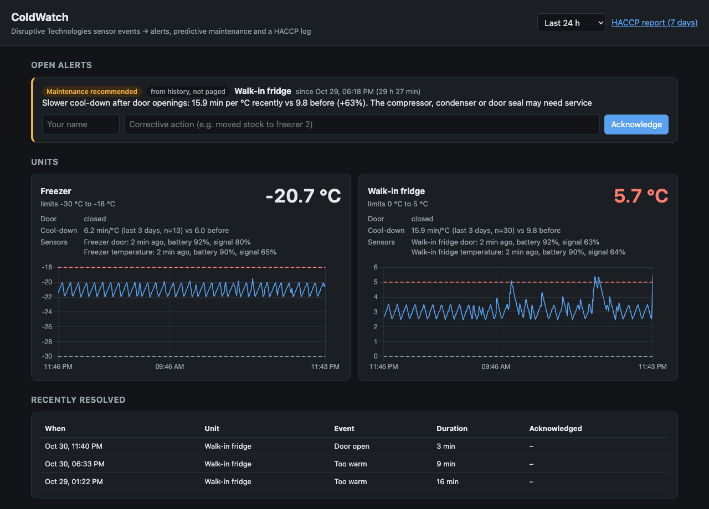
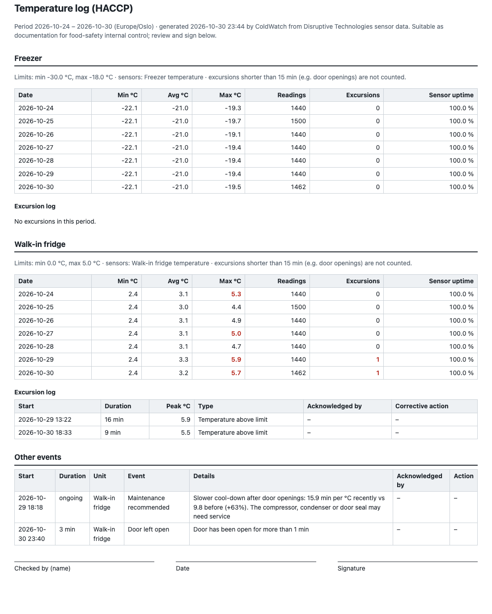

# ColdWatch

**Cold-storage monitoring built on Disruptive Technologies (DT) sensor events.** ColdWatch receives
events exactly as a DT Data Connector delivers them. It raises alerts when food is at risk and
escalates them if nobody responds. It warns that a fridge is starting to fail *before* the
fridge goes out of range, and it writes the temperature log a kitchen has to keep anyway.

No DT account or hardware is needed to try it. A simulator produces realistic DT events from a
simple thermal model of a walk-in fridge and a freezer.



*Dashboard after 14 simulated days of a slowly failing compressor, plus a door left open.
The fridge cools down 63 % slower after door openings than it used to, so ColdWatch
recommends service before the food is at risk.*

<details>
<summary>HACCP temperature log (printable report)</summary>



</details>

## Why

Restaurants, shops and hospitals check fridge temperatures by hand and write them on paper,
because food-safety internal control (HACCP) requires a log. DT's sensors already measure
temperature and door openings for years on a battery. ColdWatch is the application layer
on top: what should happen when the data says something is wrong?

- **Act on real problems only.** A door opening briefly pushes the air temperature over the
  limit, and that is normal. A fridge that stays warm for 15 minutes is not.
- **Make sure someone acts.** If the person on shift doesn't acknowledge an alert, it goes to
  the manager.
- **See failures coming.** Each door opening is a free stress test of the compressor. When the
  fridge needs longer and longer to cool back down, it is time to call the service company.
- **Make the paperwork automatic.** The daily min/avg/max, every excursion and every corrective
  action end up in a printable report.

## Architecture

```
 DT temperature sensor ─┐
 DT proximity sensor   ─┼─► Cloud Connector ─► DT Cloud ─► Data Connector ── HTTPS POST ──┐
 (door, PRESENT=closed) │  (sub-GHz radio,                (webhook, at-least-once,       │
                        │   cellular/ethernet)             X-Dt-Signature JWT)            │
                                                                                          ▼
 python -m coldwatch.simulator ── same JSON body, same signature ──────────────►  POST /dt/events
                                                                                          │
   ┌──────────────────────────────────── ColdWatch ──────────────────────────────────────┤
   │  verify signature (raw bytes) → dedup by eventId → rules engine (event time)        │
   │      ├─ excursions with grace period, door left open, sensor offline, battery       │
   │      ├─ door-cycle analysis → predictive maintenance warning                        │
   │      └─ alerts → notify staff → escalate to manager (console, ntfy.sh, webhook)     │
   │  SQLite  →  dashboard (/)  ·  JSON API (/api/*)  ·  HACCP report (/report)          │
   └─────────────────────────────────────────────────────────────────────────────────────┘
```

## Quick start

```bash
cd coldwatch
python3 -m venv .venv && source .venv/bin/activate
pip install -e ".[dev]"
pytest                                    # 46 tests, about 3 s

export DT_SIGNATURE_SECRET=$(python3 -c "import secrets; print(secrets.token_hex(24))")
DOOR_OPEN_MAX_S=60 ESCALATE_AFTER_S=90 uvicorn coldwatch.app:app --port 8000
```

In a second terminal, with the same `DT_SIGNATURE_SECRET` exported:

```bash
python -m coldwatch.simulator backfill --days 14 --scenario compressor-degrading   # ~7,400 events in ~5 s
python -m coldwatch.simulator live --scenario door-left-open --interval 5
```

Then open <http://127.0.0.1:8000> for the dashboard and <http://127.0.0.1:8000/report?days=7>
for the report.

The scenarios are `normal`, `door-left-open`, `power-outage`, `compressor-degrading`,
`sensor-offline` and `battery-low`. In `backfill` mode the incident lands in the last two days
of history. In `live` mode it starts a few seconds after launch. To get push notifications on
your phone, install the free ntfy app, subscribe to a topic, and start the server with
`NTFY_TOPIC=<topic>`.

## Three-minute demo

1. **Dashboard after the backfill.** The walk-in fridge shows *Maintenance recommended*:
   for example "16.5 min per °C recently vs 9.7 before (+70%)". With the default settings the
   warning comes roughly a day before the fridge first stays above 5 °C for 15 minutes. Two weeks of
   history are replayed, but nobody is paged about last Tuesday (see design decisions).
2. **Live incident.** Run the `door-left-open` scenario. After a minute a door alert goes to
   staff (in the console, or on your phone with ntfy). After 90 more seconds without an
   acknowledgement it is escalated to the manager. Acknowledge it in the dashboard with a
   corrective action.
3. **Report.** Open `/report` and print it to PDF. It contains daily min/avg/max, excursions,
   sensor uptime, who acknowledged what and what they did, and a sign-off line.
4. **Code.** Show `dt.py` (the signature is checked on the raw body) and `engine.py` (rules
   run on event time, which is why replayed and retried events behave correctly).

## Connecting a real DT Data Connector

1. Make ColdWatch reachable over HTTPS. For testing, `ngrok http 8000` is enough.
2. In DT Studio, create a Data Connector with the endpoint `https://<host>/dt/events` and set its
   signature secret to `DT_SIGNATURE_SECRET`.
3. Configure the connector to forward these device labels: `name`, `unit`, `role`, `max_temp`,
   `min_temp`.
4. Label the sensors. For example, a temperature sensor gets `unit=Walk-in fridge`,
   `role=temperature`, `max_temp=4`, and the door's proximity sensor gets
   `unit=Walk-in fridge`, `role=door`. Without labels each sensor becomes its own unit with
   `DEFAULT_MAX_TEMP` as its limit.

ColdWatch handles `temperature`, `humidity` (its temperature reading), `objectPresent`,
`batteryStatus` and `networkStatus`. It answers 200 to other event types so DT doesn't retry them.

## Configuration

| Variable | Default | Meaning |
|---|---|---|
| `COLDWATCH_DB` | `coldwatch.db` | SQLite file |
| `DT_SIGNATURE_SECRET` | – | When set, requests without a valid `X-Dt-Signature` are rejected (400 missing / 401 invalid) |
| `EXCURSION_GRACE_S` | 900 | How long a temperature must stay out of range before it counts |
| `DOOR_OPEN_MAX_S` | 300 | Door-open alert |
| `ESCALATE_AFTER_S` | 600 | Unacknowledged alerts go to the manager after this |
| `OFFLINE_MIN_S` | 900 | DT's offline rule is `max(15 min, 1.5 × heartbeat)`; this sets the 15 min floor |
| `HISTORICAL_S` | 600 | Events older than this on arrival are logged but never paged |
| `DEFAULT_MAX_TEMP` / `DEFAULT_MIN_TEMP` | 4 / – | Limits for sensors without labels |
| `NTFY_TOPIC`, `NTFY_SERVER` | –, `https://ntfy.sh` | Phone push notifications |
| `ALERT_WEBHOOK_URL` | – | POST each notification as JSON (Slack bridge, Teams, your own system) |
| `COLDWATCH_TZ` | `Europe/Oslo` | Day boundaries in the report |

## Design decisions

- **At-least-once delivery means dedup.** DT retries every event that doesn't get a 2XX within
  10 s, for up to 12 hours. Each event is processed in a single SQLite transaction that also
  records its `eventId`. A failure rolls everything back and returns 500, so DT's retry is
  safe. A duplicate is answered `200 {"status": "duplicate"}`.
- **The checksum is computed over the raw bytes.** The JWT's `checksum_sha256` covers the
  exact body DT sent. Parsing and re-serialising the JSON would change the bytes, so
  verification happens before parsing.
- **Rules run on event time.** Every rule uses the time the sample was taken, not when the
  request arrived. A backlog delivered after an outage, or two weeks of simulated history,
  produces the same alerts the live stream would have. Only "nothing has happened for a while"
  checks run on the wall clock (door still open, sensor silent, nobody acknowledged), and only
  for sensors that are currently live. Alerts found in replayed history are stored for the log
  but never notify anyone.
- **Grace periods.** Short excursions are normal and are not alerts. The report says so
  explicitly. The default of 15 minutes is a setting, not a regulation.
- **Escalation instead of louder alarms.** The problem in a busy kitchen is rarely that no
  alert was sent. It is that nobody owned it. Escalation and acknowledgement with a corrective
  action fix that, and the acknowledgement is also what an inspector wants to see.
- **Notifications are sent outside the request.** The engine queues them and a background
  loop sends them, so a slow push service can never make DT time out.

### Predictive maintenance: method and limits

For each door opening ColdWatch records three things. The *baseline* is the median temperature
in the 30 minutes before the door opened. The *peak* is the highest temperature after it. The
*recovery time* is how long after the door closed the temperature was back within 0.5 °C of the
baseline. Dividing recovery time by how far the unit had to cool (peak minus target) gives
**minutes per °C**: the unit's pull-down speed. This doesn't depend on how long the door was
open or where the thermostat was in its cycle. Openings that warmed the unit by less than
0.5 °C are skipped as too noisy, and so are openings followed by another opening before
recovery.

A warning is raised when the median of the last 3 days is at least 1.5× the median of the 30
days before, and at least 1 min/°C worse, with at least 20 measured openings in each window.
It clears below 1.25× (hysteresis). In the simulator a healthy fridge stays between 8.8 and 9.5
min/°C per day. With a compressor losing 45% capacity over a week, the warning comes roughly a
day before the first real excursion (a test checks that order).

Limits, stated honestly:

- The thresholds were tuned on simulated data and must be validated on real units.
- Seasonal kitchen temperature, warm deliveries and sensor placement all affect pull-down
  speed. A real version should normalise for ambient temperature (DT has humidity and
  temperature sensors for that).
- It needs a door sensor and a few busy days of history.
- With DT's default of 1 sample per 15-minute heartbeat, recovery times have 15-minute
  resolution. Configuring more samples per heartbeat (newer DT temperature sensors support
  this) makes them much sharper. The simulator uses 15 samples per heartbeat.

## What I'd do next

- Verify DT's asymmetric `DT-Asymmetric-Signature` (ES256, keys from DT's JWKS endpoint) so no
  shared secret is needed.
- Add authentication to the dashboard and API. Today they are open, which is fine on localhost
  but not on the internet.
- Move to Postgres/TimescaleDB, and make it multi-tenant per DT organisation and project.
- Fetch device metadata and labels from DT's REST API instead of depending on forwarded labels.
- Normalise pull-down speed for ambient temperature. Detect door-seal leaks (slow warming with
  the door closed) and compressor short-cycling.

## Project layout

```
coldwatch/
  dt.py           DT formats: parse events, verify/sign X-Dt-Signature, build payloads
  engine.py       rules engine: readings, door cycles, alerts, escalation
  maintenance.py  pull-down speed assessment
  report.py       HACCP-style printable report
  notify.py       console / ntfy.sh / webhook notifications
  app.py          FastAPI: /dt/events, /api/*, /report, dashboard
  simulator.py    thermal model + scenarios, sends DT-format events
  static/index.html  dashboard (vanilla JS + Chart.js)
tests/            46 pytest tests (signatures, parsing, rules, maintenance, report, API)
```
